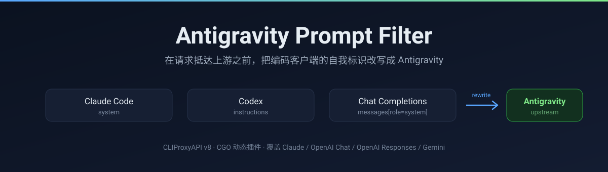

<p align="center">
  
</p>

<p align="center">
  <a href="https://github.com/DongHua3/cpa-plugin-antigravity/releases"></a>
  
  
  
</p>

<p align="center">
  在请求抵达 Antigravity 上游之前，把编码客户端的自我标识改写成 <code>Antigravity</code>。<br>
  其余字节原样保留 —— 用户消息、工具调用、工具输出一个字都不动。
</p>

---

## 它解决什么

用 CLIProxyAPI 把 Codex、Claude Code、DeepSeek Harness 这类客户端接到 Antigravity 通道时，请求体里会带着客户端自己的名字：

```
You are Codex, a coding agent...
You are Claude Code, Anthropic's official CLI for Claude...
```

这些字段到了上游就是一行"我不是官方客户端"的自述。本插件在 `request.intercept_before` 阶段把它们换成 `Antigravity`，让上游收到的系统提示保持口径一致。

改写只发生在**系统提示**范围内，并且大小写不敏感。用户消息里恰好提到这些名字（比如你在讨论 Cursor 这个编辑器），不会被误改。

## 支持的协议

目标字段由宿主下发的 `SourceFormat` 决定，四种入口协议全部覆盖：

| SourceFormat | 系统提示所在位置 |
| --- | --- |
| `claude` / `antigravity` | `system`（字符串或 `[{type:"text"}]`） |
| `openai` | `messages[].content`，`role` 为 `system` 或 `developer` |
| `openai-response` / `codex` | `instructions`，以及 `input[].content` 中 `role` 为 `system` 或 `developer` 的项 |
| `gemini` | `systemInstruction.parts[].text` |

未知格式原样放行 —— 插件不猜字段名。

## 两种模式

| 模式 | 行为 | 适用场景 |
| --- | --- | --- |
| `rewrite`（推荐） | 命中词替换为 `Antigravity`，请求继续转发 | 你自己就是用这些客户端在驱动代理 |
| `block` | 命中即拒绝，返回 `403 blocked_by_antigravity_coding_filter` | 想拦住别人拿你的 key 跑竞品客户端 |

> **`block` 当前不生效。** 它走 `model.route` 路由到插件自己的执行器，但宿主只有在插件能解析出 executor provider 标识（`executor.identifier` 或已注册的模型提供商）时才接受自路由。本插件两者都没声明，宿主会记录 `pluginhost: model router returned unavailable executor plugin` 并回退到正常路由 —— 命中的请求被转发而不是被拒绝。`rewrite` 不受影响，它走的是拦截器。修复方案是改用 v8 的 `Terminate` 字段。

## 内置词表

默认启用，覆盖主流 AI 编码编辑器、助手与终端代理：

- Claude Code、OpenAI Codex / Codex CLI、OpenCode
- GitHub Copilot / Copilot CLI、Gemini Code Assist / Gemini CLI
- Cursor、Windsurf / Codeium、Cline、Roo Code、Kilo Code、Aider、Continue.dev
- Amazon Q Developer / CodeWhisperer、JetBrains AI Assistant / Junie、Kiro
- Qoder / Qoder CLI、Qwen Code、Trae、Tabnine、Sourcegraph Cody、Augment Code
- Replit Agent / Ghostwriter、Devin、OpenHands、SWE-agent、Goose
- Zed AI、Void Editor、PearAI、Refact.ai、Tabby、GitLab Duo、Visual Studio IntelliCode
- CodeBuddy、Blackbox AI、Pieces for Developers、Qodo / CodiumAI、Rovo Dev CLI、Factory Droid
- OpenClaw（含 Clawdbot、Moltbot）、Hermes Agent、WorkBuddy

词表里没有的（例如 `DeepSeek Harness`）通过 `custom_mappings` 补。

## 配置

```yaml
plugins:
  enabled: true
  dir: "plugins"
  configs:
    antigravity-coding-filter:
      enabled: true
      priority: 1
      mode: rewrite
      use_default_keywords: true
      custom_mappings:
        DeepSeek Harness: Antigravity
```

- `rewrite` 模式下，映射的 key 被替换成 value。
- `block` 模式下，key 是额外的屏蔽词，value 被忽略。
- `custom_mappings` 也接受逗号或换行分隔的 `原名: 替换值` 字符串；空项与重名项会被忽略。

插件目录搜索顺序：`plugins/<GOOS>/<GOARCH>-<variant>` → `plugins/<GOOS>/<GOARCH>` → `plugins`。插件 ID 取自动态库文件名，因此必须是 `antigravity-coding-filter`。

## 安装

从 [Releases](https://github.com/DongHua3/cpa-plugin-antigravity/releases) 下载对应平台的压缩包，解压后放到：

```
plugins/windows/amd64/antigravity-coding-filter.dll
plugins/linux/amd64/antigravity-coding-filter.so
plugins/darwin/arm64/antigravity-coding-filter.dylib
```

## 构建

需要 CGO 与 C 工具链。

```powershell
$env:CGO_ENABLED = 1

# Windows
go build -buildmode=c-shared -o plugins/windows/amd64/antigravity-coding-filter.dll .
Remove-Item plugins/windows/amd64/antigravity-coding-filter.h

# Linux
go build -buildmode=c-shared -o plugins/linux/amd64/antigravity-coding-filter.so .

# macOS
go build -buildmode=c-shared -o plugins/darwin/arm64/antigravity-coding-filter.dylib .
```

## 验证

启动 CLIProxyAPI，日志里应出现：

```text
pluginhost: plugin loaded plugin_id=antigravity-coding-filter
pluginhost: plugin registered plugin_id=antigravity-coding-filter version=0.3.0
```

端到端确认：打开宿主的请求日志（`auths/logs/v1-*.log`），对比同一个请求的两段 body —— 入站仍带客户端原名，上游已是 `Antigravity`。

## 测试

```bash
go test ./...
```

`format_test.go` 为每种入口协议各覆盖一次改写与一次判定，另含未知格式与用户消息的放行断言。

## 边界

- 只处理**系统提示**，不处理 tool 定义、多模态内容与响应体。
- 不做 UA、header 或 `metadata` 层的伪装 —— 那些由 CLIProxyAPI 的执行器自行决定。
- `block` 模式当前不生效，见上文。
- 上游是否按系统提示判定客户端，取决于上游自身策略；本插件只保证文本口径一致，不保证绕过任何检测。

## 许可证

MIT
